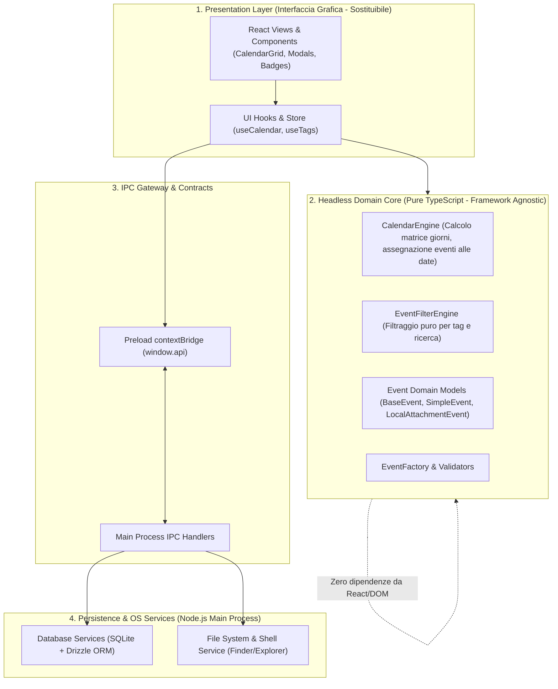
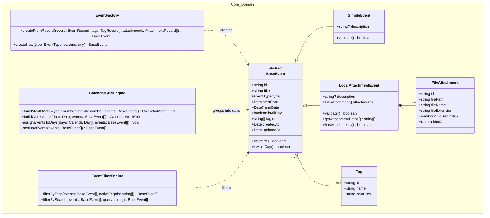
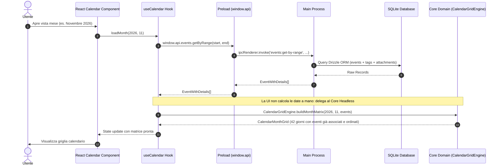

# Architettura Tecnica - Content Calendar Desktop App

**Versione:** 1.2  
**Data:** 1 Novembre 2026  
**Stato:** Approvato / Specifiche Architetturali  
**Piattaforme Target:** Windows (10/11) & macOS (Intel / Apple Silicon)

---

## 1. Panoramica del Sistema & Separazione delle Responsabilità

L'applicazione adotta una rigorosa **Clean Architecture (Headless Domain)** per disaccoppiare totalmente la logica di business e la manipolazione dei dati dall'interfaccia grafica. 

In questo modo, la logica di calcolo del calendario (calcolo dei giorni, assegnazione degli eventi alle date, filtraggio per tag, estrazione metadati allegati) è **completamente agnostica rispetto alla UI**: se in futuro si volesse sostituire React con Vue, Svelte o un'altra tecnologia, l'intero motore di dominio (`src/core/`) rimarrebbe invariato e riutilizzabile al 100%.

### I 4 Livelli Architetturali:

1. **Presentation Layer (`src/renderer/src/components/`):**
   - Componenti puramente visivi (React + Tailwind CSS).
   - Ricevono strutture dati già pronte dal Core di dominio e si limitano a renderizzarle.
   - Non contengono algoritmi di calendario né logica di aggregazione date.

2. **Headless Domain Core (`src/core/`):**
   - **Zero dipendenze da React, JSX, Electron o DOM.**
   - Scritto in TypeScript puro, testabile al 100% con test unitari velocissimi in Vitest.
   - Contiene:
     - `CalendarEngine`: genera la matrice di giorni del mese e della settimana, assegna gli eventi al rispettivo slot temporale/giorno, gestisce gli ordinamenti (eventi "Tutto il giorno" prima, poi per orario).
     - `EventFilterEngine`: applica i filtri per tag agli eventi senza toccare la UI.
     - `EventModels` & `EventFactory`: validazione, deserializzazione e manipolazione delle entità evento e allegati.

3. **IPC Gateway & Contracts (`src/preload/`, `src/shared/types.ts`):**
   - Canali di comunicazione e tipi strettamente tipizzati per trasferire i dati tra processo Renderer e Main.

4. **Persistence & OS Layer (`src/main/`):**
   - Database SQLite locale con Drizzle ORM.
   - Servizi nativi del sistema operativo (`dialog.showOpenDialog`, `shell.showItemInFolder`).

---

## 2. Stack Tecnologico

### 2.1 Runtime & Build Tooling
- **Electron:** Runtime desktop multipiattaforma.
- **TypeScript:** Tipizzazione end-to-end condivisa tra Main, Preload, Core e Renderer.
- **`electron-vite`:** Build tool basato su Vite con Hot Module Replacement (HMR).

### 2.2 Frontend & UI System (Presentation)
- **Framework UI:** **React** (versione 18+) con TypeScript.
- **Styling:** **Tailwind CSS**, per un design system snello e manutenibile.
- **Libreria Componenti:** **shadcn/ui (primitive Radix UI)**, componenti accessibili e personalizzabili.
- **Icone:** **Lucide React**.

### 2.3 Motore di Dominio del Calendario (Headless Core)
- **`src/core/calendar/` (Pure TypeScript + `date-fns`):**
  - Motore di calcolo date completamente separato dalla UI.
  - Funzioni pure che prendono in input un intervallo di date e una lista di `EventRecord` e restituiscono una matrice strutturata `CalendarMonthMatrix` o `CalendarWeekMatrix`.
  - Ogni cella contiene la data normalizzata, i flag di contesto (`isCurrentMonth`, `isToday`, `isWeekend`) e la lista degli eventi assegnati a quel giorno già ordinati.

### 2.4 Persistenza Dati (Database Locale)
- **Database Engine:** **SQLite** tramite il driver nativo precompilato ad alte prestazioni **`@libsql/client`**.
- **ORM / Query Builder:** **Drizzle ORM** (type-safe, migrazioni automatiche).
- **Archiviazione:** File di database `.sqlite` salvato in `app.getPath('userData')`.
- **Integrità:** Transazioni ACID, foreign keys attive e cancellazioni a cascata (`ON DELETE CASCADE`).

### 2.5 Integrazione col File System Locale
- `shell.showItemInFolder(fullFilePath)`: Funzione nativa di Electron per aprire Finder (macOS) o Explorer (Windows) evidenziando il file.
- `dialog.showOpenDialog(...)`: Finestra di selezione file nativa del sistema operativo.
- `node:fs/promises` & `node:path`: Normalizzazione dei percorsi e verifica dell'esistenza fisica dei file.

---

## 3. Architettura delle Classi & Pattern di Estensibilità

---

## 4. Flusso dei Dati e Contratti IPC (Sequence Diagram)

### Scenario: Calcolo e Rendering del Calendario

---

## 5. Schema Dati Relazionale (SQLite con Drizzle ORM)

### Tabella `events`
| Campo | Tipo | Note |
|---|---|---|
| `id` | TEXT PRIMARY KEY | UUIDv4 |
| `type` | TEXT NOT NULL | `'simple'` \| `'attachment'` \| *futuri tipi* |
| `title` | TEXT NOT NULL | Titolo dell'evento |
| `description` | TEXT | Testo / Note |
| `start_date` | TEXT NOT NULL | ISO 8601 string |
| `end_date` | TEXT | ISO 8601 string |
| `is_all_day` | INTEGER NOT NULL | 0 = false, 1 = true |
| `metadata` | TEXT | JSON serializzato per attributi futuri |
| `created_at` | TEXT NOT NULL | ISO 8601 string |
| `updated_at` | TEXT NOT NULL | ISO 8601 string |

### Tabella `tags`
| Campo | Tipo | Note |
|---|---|---|
| `id` | TEXT PRIMARY KEY | UUIDv4 |
| `name` | TEXT NOT NULL UNIQUE | Nome univoco del tag |
| `color_hex` | TEXT NOT NULL | Codice colore esadecimale (es. `#3B82F6`) |

### Tabella `event_tags` (Many-to-Many)
| Campo | Tipo | Note |
|---|---|---|
| `event_id` | TEXT NOT NULL | Foreign Key → `events(id)` ON DELETE CASCADE |
| `tag_id` | TEXT NOT NULL | Foreign Key → `tags(id)` ON DELETE CASCADE |
| *PRIMARY KEY* | `(event_id, tag_id)` | Chiave primaria composta |

### Tabella `event_attachments` (One-to-Many)
| Campo | Tipo | Note |
|---|---|---|
| `id` | TEXT PRIMARY KEY | UUIDv4 |
| `event_id` | TEXT NOT NULL | Foreign Key → `events(id)` ON DELETE CASCADE |
| `file_path` | TEXT NOT NULL | Percorso assoluto del file locale |
| `file_name` | TEXT NOT NULL | Nome originale del file con estensione |
| `file_extension` | TEXT NOT NULL | Estensione normalizzata (es. `.mp4`, `.pdf`) |
| `added_at` | TEXT NOT NULL | ISO 8601 string |

---

## 6. Considerazioni Cross-Platform e Specifiche macOS

1. **Azione "Mostra nella Cartella" (`shell.showItemInFolder`):**  
   Su macOS invia il comando nativo Cocoa al Finder (`NSWorkspace activateFileViewerSelectingURLs:`), il quale gestisce la visualizzazione senza richiedere permessi speciali all'applicazione.
2. **Selezione File (`dialog.showOpenDialog`):**  
   La selezione volontaria dell'utente tramite file picker nativo conferisce autorizzazione esplicita (*user intent*).
3. **Normalizzazione Percorsi:**  
   Il modulo `src/core/` normalizza sempre i separatori (`/` su macOS e `\` su Windows) prima di qualsiasi persistenza o chiamata di sistema.
4. **Scorciatoie da tastiera:**  
   Supporto trasparente a `Cmd` su macOS e `Ctrl` su Windows.
